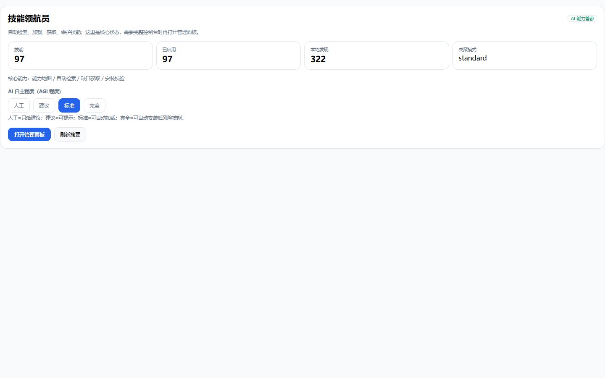

# dsh-skill-radar

> **A lightweight automatic skill radar for DeepSeek Harness.** It finds the right skill automatically, loads only strong matches, and lets you acquire, scan, install, and roll back skills safely.

[](https://github.com/CQQOOQ123/dsh-skill-radar/actions/workflows/ci.yml)
[](https://github.com/CQQOOQ123/dsh-skill-radar/releases)
[](LICENSE)

[中文](README.md) | English



## Why

A large skill catalog is not free: every turn spends context on descriptions, the model still has to choose, and there is no safe way to acquire missing skills.

`dsh-skill-radar` keeps one loop:

```text
task starts
  → automatic scout
  → auto-load the single strongest match
  → acquire online when capability is missing
  → static security scan
  → human-confirmed install
  → rollback when needed
```

## Features

- BM25F retrieval with Chinese/English expansion and coverage gating;
- Auto-load at most one strongly matched skill body;
- Enable / disable / pin / usage stats;
- Four autonomy levels, changeable only by a human;
- `capability_check` before acquiring duplicates;
- Online skill search, explicitly opt-in;
- Static security scan before install;
- Install with confirmation, integrity verification, and rollback;
- Local skill directory discovery.

## Quick start

Install from the DSH plugin manager:

```text
https://github.com/CQQOOQ123/dsh-skill-radar
```

After npm publication:

```bash
dsh plugin add dsh-skill-radar
```

Requirements: DeepSeek Harness Web UI, Node.js 20+. Windows-first; Linux/macOS are not yet verified on real machines.

## Safety

- Writes are loopback-only, same-origin/CSRF protected, and require a write token;
- Install requires confirmation, or explicit `full + autoAcquire`;
- Post-install integrity check with automatic rollback;
- State is backed up before writes and recoverable after corruption;
- Pinned skills cannot be auto-disabled.

This is a single-user, local-first plugin. It is not a multi-user service, and the security scan is heuristic — not a guarantee.

## Development

```bash
node ci.mjs
node lite-test.mjs
```

UI tests are development dependencies and need a local Edge browser.

## License

MIT
