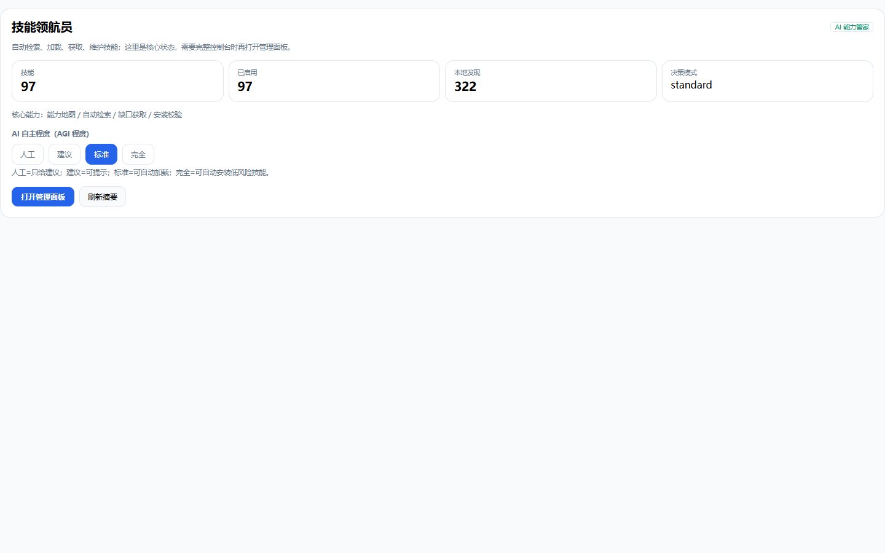

# dsh-skill-radar

> **轻量自动化技能雷达。** 自动找出该用哪个技能，强匹配才加载，缺能力时在线找、预检、安装、可回滚。

[](https://github.com/CQQOOQ123/dsh-skill-radar/actions/workflows/ci.yml)
[](https://github.com/CQQOOQ123/dsh-skill-radar/releases)
[](LICENSE)

DeepSeek Harness 的轻量插件。它不把几百个技能说明一次性塞进上下文，而是按任务检索、只给候选、强匹配才加载正文。



---

## 为什么需要它

技能越装越多，问题不是“没有技能”，而是：

- 模型每轮都要自己扫目录，浪费 token；
- 不知道该用哪个，或者一次选太多；
- 想开关/置顶技能，却要删文件；
- 缺能力时，找技能 → 判断安全 → 安装 → 回滚，链路太长。

`dsh-skill-radar` 只做这一条闭环：

```text
任务开始
  → 自动检索
  → 强匹配自动加载 1 个
  → 缺能力时在线找
  → 安全预检
  → 人工确认安装
  → 不满意可回滚
```

---

## 核心能力

| 能力 | 说明 |
|---|---|
| 本地技能检索 | BM25F + 中英互扩 + 标题重排 + 覆盖率门槛 |
| 自动加载 | 标准模式下强匹配最多加载 1 个正文，避免上下文膨胀 |
| 技能管理 | 启用/禁用/置顶/统计 |
| 四档自主度 | 人工 / 建议 / 标准 / 完全；模式只能由人切换 |
| 能力缺口检查 | 先判断是否已有能力，避免重复找 |
| 在线找技能 | 显式联网，结果默认不可信，不自动安装 |
| 安全预检 | 静态规则扫描命令执行、网络、凭据、写文件等风险 |
| 安装/回滚 | 人工确认，安装后校验，失败自动回滚 |
| 目录发现 | 扫描本机技能目录，添加后即可被检索 |

---

## 快速开始

### 通过 DSH 插件管理器（推荐）

在 DSH 的“插件”页面添加本仓库，或使用插件管理器安装：

```text
https://github.com/CQQOOQ123/dsh-skill-radar
```

npm 发布后也可以直接安装：

```bash
dsh plugin add dsh-skill-radar
```

### 本地开发

```bash
git clone https://github.com/CQQOOQ123/dsh-skill-radar
cd dsh-skill-radar
node ci.mjs
```

要求：

- DeepSeek Harness Web UI
- Node.js 20+
- Windows 优先；Linux/macOS 未实机验证

---

## 自主度

| 模式 | 行为 |
|---|---|
| 人工 | 不主动检索；你要求时才用 |
| 建议 | 每轮给候选，不自动加载 |
| 标准 | **默认**：候选 + 强匹配自动加载 1 个 |
| 完全 | 额外允许 AI 开关技能；插件开关仍默认禁止 |

模式只能由人在设置页切换，AI 不能自己升档。

---

## 安全边界

- 本机写接口：只允许 loopback + 同源 Origin/CSRF + 写 token；
- 安装：人工确认，或 `full + autoAcquire` 授权；
- 安装后校验完整性，失败自动回滚；
- 状态文件写前备份，损坏时从最近备份恢复；
- 资源路径限制在 storeDir / 安装目录内；
- 置顶技能不能被自动禁用。

这是单机单用户插件，没有多用户鉴权。

安全预检是**静态启发式**，不能保证 100% 安全；安装前仍建议审阅技能正文。

---

## 适用 / 不适用

**适合：**

- 装了很多技能，目录开始挤上下文；
- 想自动找技能，但不想自动装；
- 想要一个轻量、本地优先、可回滚的技能管理器。

**不适合：**

- 需要团队策略/集中审计；
- 需要市场、MCP 打包、格式转换；
- 需要多用户/服务端部署。

完整版能力对比见 [COMPARISON.md](COMPARISON.md)。

---

## 开发

```bash
node ci.mjs                 # 语法 + 契约 + 客户端注册
node lite-test.mjs          # 工具/路由/检索冒烟
node ui-tests/run.mjs       # Playwright UI 验收（需本机 Edge）
```

`ui-tests` 是开发依赖，不在插件运行时依赖里。

---

## Roadmap

- [ ] npm 发布
- [ ] 英文 README
- [ ] 自动加载的 demo GIF
- [ ] 更多检索评测样本
- [ ] 可选语义重排

---

## License

MIT
